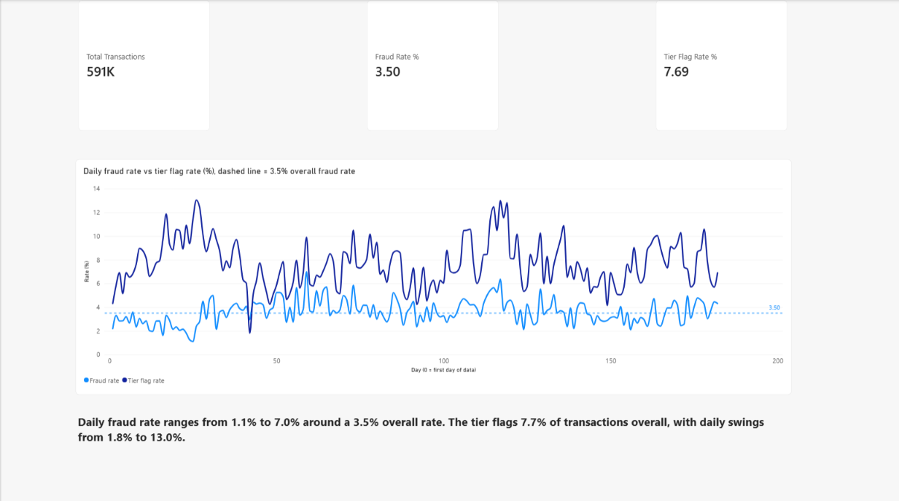
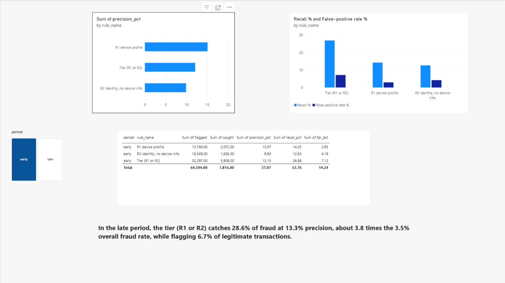
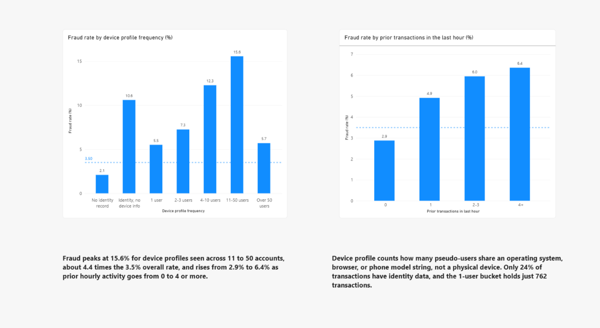

# Fraud and Promo-Abuse Risk Signal Lab

An end-to-end Trust and Safety analytics project built on the public IEEE-CIS Fraud Detection dataset. It engineers user-level risk signals in MySQL, finds fraud patterns, turns them into detection rules, compares the rules with an Isolation Forest anomaly model, validates the rules in a simulated treatment-vs-holdout rollout, and automates daily risk monitoring with a number-verified LLM summary and a Power BI dashboard.

**Problem:** super-apps lose money and user trust to fraud and abuse, and analysts have to catch bad actors without blocking good users. This project asks which signals actually separate fraud from normal activity, which rules are worth shipping, and what they cost in false positives.

**Stack:** Python, MySQL 8, Pandas, scikit-learn, SciPy, pytest, Power BI, NVIDIA NIM.

## Key results

| Finding | Result |
|---|---|
| Dataset | 590,540 transactions, 20,663 frauds (3.50%), 182 days, 41,672 pseudo-users |
| Identity record present | 24% of transactions but 54.8% of fraud (7.85% fraud rate vs 2.09% without, about 3.8x) |
| Device profile seen across 11 to 50 users | 15.56% fraud rate, about 4.4x the baseline |
| Prior activity in the last hour | Fraud rate rises from 2.88% (0 prior transactions) to 6.36% (4 or more) |
| Raw transaction amount | No signal (AUC 0.498). Amount relative to the user's own average is weakly predictive (AUC 0.557) |
| Best rule tier (late 30% of time) | 13.33% precision, 28.56% recall, 6.65% false-positive rate, 3.85x lift |
| Isolation Forest (same alert volume) | 8.30% precision, 17.80% recall, AUC 0.709 |
| Simulated rollout of the tier | About 27% to 31% fewer fraudulent transactions getting through (95% interval 14% to 44%), at a 5.9% false-decline rate |
| Daily monitor | 10 anomalous days out of 182 |

## Dashboard

Power BI file: `dashboard/risk_dashboard.pbix`





## Data

IEEE-CIS Fraud Detection (Kaggle): `train_transaction.csv` and `train_identity.csv`. The files are not in this repo. Download them from the Kaggle competition page and place them in `data/`.

The dataset has no user ID, so a **pseudo-user** is defined as the combination `card1 + card2 + addr1`. Candidate keys gave 13,553 users (`card1` only), 41,672 users (three columns, used here) and 42,946 users (five columns). The three-column key sits in the middle and avoids lumping unrelated people together or splitting every user into one transaction.

Only 144,233 transactions (24%) have a matching identity record, so device features cover that subset.

## Approach

### 1. SQL feature layer (`sql/`)

Features are computed per pseudo-user with window functions, using only **past** transactions so no future information leaks into a signal:

- `tx_cnt_1h`, `tx_cnt_24h`, `tx_cnt_7d`: prior transactions in the last hour, day and week
- `amt_ratio`: amount divided by the user's own prior average
- `secs_since_prev` and `tx_seq`: time since the previous transaction and position in the user's history
- `has_identity` and `users_on_device`: whether an identity record exists, and how many pseudo-users share the same device profile string

### 2. Findings (`notebooks/01_findings.ipynb`)

Feature strength by AUC (0.5 means no separation):

| Feature | AUC |
|---|---|
| has_identity | 0.657 |
| secs_since_prev | 0.396 (shorter gaps go with more fraud) |
| tx_cnt_24h | 0.582 |
| tx_cnt_1h | 0.572 |
| tx_cnt_7d | 0.571 |
| amt_ratio | 0.557 |
| tx_seq | 0.555 |
| TransactionAmt | 0.498 |

Fraud rate by device profile frequency:

| Device profile | Transactions | Fraud rate |
|---|---|---|
| No identity record | 446,307 | 2.09% |
| Identity record, no DeviceInfo | 25,567 | 10.60% |
| 1 user | 762 | 5.51% |
| 2 to 3 users | 1,641 | 7.25% |
| 4 to 10 users | 4,367 | 12.27% |
| 11 to 50 users | 15,488 | 15.56% |
| Over 50 users (generic OS or browser strings) | 96,408 | 5.70% |

One expectation did not hold: fraud was slightly **less** likely to be a user's first transaction (5.5% of fraud vs 7.1% of legitimate), so activity depth mattered more than newness.

### 3. Detection rules

Rules were evaluated on the first 70% of time (early) and the last 30% (late):

| Rule | Early precision | Late precision | Late recall | Late false-positive rate | Late lift | Decision |
|---|---|---|---|---|---|---|
| R1: identity record and device profile shared by 4 to 50 users | 15.07% | 14.31% | 14.27% | 3.06% | 4.14x | Ship |
| R2: identity record but no device info | 9.90% | 12.47% | 14.29% | 3.59% | 3.61x | Ship |
| **Tier (R1 or R2)** | 12.10% | **13.33%** | **28.56%** | **6.65%** | **3.85x** | **Ship** |
| Velocity (4 or more prior transactions in 1 hour) | 7.11% | 4.45% | 3.44% | 2.65% | 1.29x | Dropped, does not hold over time |
| Amount ratio above 3 | 4.09% | 5.46% | 7.93% | 4.92% | 1.58x | Dropped, too noisy |

Combining every initial rule with OR flagged about 31% of legitimate transactions for 55% recall, so a tiered design was used instead. Requiring two or more rules to fire together gave 9.74% precision at 0.84% false-positive rate but only 2.53% recall.

### 4. Isolation Forest comparison

An Isolation Forest was trained without labels on the early 70% of time and scored on the late 30%, with its alert threshold set to the same alert volume as the tier (13,125 transactions), so the comparison is at equal review workload.

| Setup (late period) | Flagged | Precision | Recall | False-positive rate | Lift |
|---|---|---|---|---|---|
| Rule tier | 13,125 | 13.33% | 28.56% | 6.65% | 3.85x |
| Isolation Forest | 13,125 | 8.30% | 17.80% | 7.04% | 2.40x |
| Both fire | 3,622 | 10.57% | 6.25% | 1.89% | 3.06x |
| Either fires | 22,628 | 10.85% | 40.10% | 11.79% | 3.14x |

The forest ranks the whole population better than any single feature (AUC 0.709), but the hand-built tier is more precise in the top slice. Only 383 of the 2,456 frauds caught by either method are caught by both, so the two approaches find different fraud. That supports a two-queue design: the tier for priority review, forest-only hits for lower-priority review.

### 5. Simulated rollout

In the late period, pseudo-users were randomly assigned to a treatment arm (policy applied, 87,757 transactions) or a holdout (89,405 transactions). Flagged fraud is assumed to be stopped.

| Policy | Fraud rate through treatment | Holdout fraud rate | Reduction vs holdout | Baseline-adjusted reduction | 95% cluster-bootstrap interval | False-decline rate |
|---|---|---|---|---|---|---|
| Tier | 2.447% | 3.566% | 31.4% | 26.9% | 13.6% to 44.0% | 5.93% |
| Tier or forest | 2.059% | 3.566% | 42.3% | 38.5% | 27.4% to 52.4% | 10.21% |

The two arms were slightly imbalanced by chance (3.347% vs 3.566% raw fraud before any policy), so the baseline-adjusted figure is the more conservative estimate. A plain transaction-level z-test overstates certainty because a user's transactions are correlated, so the interval comes from a bootstrap that resamples whole users. Adding the forest to the tier prevents more fraud but doubles the false declines, so the tier alone is the efficient layer.

### 6. Daily monitoring and LLM digest (`src/risk_metrics.py`, `src/risk_digest.py`)

- Daily fraud rate, tier flag rate, average forest score, volume and average amount are compared with the previous 14 days (the current day is excluded from its own baseline).
- Alerts fire only on the three risk metrics at 3 or more standard deviations, which flagged 10 of 182 days. Volume and amount are context only, because an earlier version that alerted on all five metrics flagged 32 days.
- For a flagged day, a model served through NVIDIA NIM writes a short summary. Every number in the text is checked against the source data, and if any figure does not match, the script retries and then falls back to a plain template.
- Example: on day 171, average forest score was 0.513 against a 14-day baseline of 0.467 (z 5.26).

## Repository layout

```
sql/
  schema.sql
  02_user_key.sql
  03_tx_features.sql
  04_device_features.sql
  05_dashboard_views.sql
src/
  ingest.py
  risk_metrics.py
  risk_digest.py
notebooks/
  01_findings.ipynb
tests/
  test_data_quality.py
dashboard/
  risk_dashboard.pbix
  screenshots/
```

## How to run

Requirements: Python 3.12 or later, MySQL 8.0 or later (window functions need it), Power BI Desktop for the dashboard.

```
python -m venv venv
venv\Scripts\Activate.ps1
pip install -r requirements.txt
```

Create a `.env` file in the project root:

```
DB_USER=fraud_user
DB_PASS=your_password
DB_HOST=localhost
DB_NAME=fraud_lab
NVIDIA_API_KEY=your_key
NVIDIA_MODEL=a_current_text_model_name
```

Then:

1. Create the `fraud_lab` database and a user, and run `sql/schema.sql`.
2. Put the two Kaggle CSV files in `data/` and run `python src/ingest.py`.
3. Run `sql/02_user_key.sql`, `sql/03_tx_features.sql` and `sql/04_device_features.sql` in order.
4. Run all cells in `notebooks/01_findings.ipynb`. The last cells write the `tx_scored` table. After they run, set `forest_flag` to NULL for the early period, because the forest alert threshold is only defined on the late period.
5. Run `sql/05_dashboard_views.sql`, then open `dashboard/risk_dashboard.pbix` and refresh it.
6. Run `python src/risk_metrics.py` and `python src/risk_digest.py`.
7. Run `pytest -v` for the 7 data-quality tests.

The digest reads its model name from `.env` because hosted model names get retired. If the key or model is missing, it prints the template summary instead of failing.

## Limitations

- **Public data and pseudo-users.** The data is a public competition dataset, and pseudo-users are built from card and address columns, so they are not real accounts. Results say nothing about production performance.
- **Identity coverage.** Only 24% of transactions have identity data, so the strongest signals apply to that subset. The strength of "identity record present" may partly reflect how the dataset was assembled, not real behaviour.
- **Device profile is not a physical device.** `DeviceInfo` holds operating system, browser and phone-model strings, so `users_on_device` measures how common a profile is, not whether accounts share one device.
- **Not fully out-of-sample.** `users_on_device` is counted over the whole dataset, including later periods, and the R1 and R2 thresholds were chosen from full-data bucket tables. Only the velocity and amount thresholds were tuned on early data alone. The late-period results are therefore somewhat optimistic for the device rules.
- **Simulated rollout.** The rollout assumes every flagged fraud is stopped, so the reduction mostly reflects the rule's recall. Fraudsters adapt in real life, and a 5.9% false-decline rate is too high for hard blocks, so the tier would be better used to trigger step-up verification.
- **Small buckets.** The 1-user device bucket holds only 762 transactions and should not drive a rule.
- **Label delay.** The monitor uses fraud labels, which arrive late in production. A live version would lean on the tier flag rate and score drift, and treat fraud rate as a lagging check.
- **LLM digest.** The number check verifies the figures in the summary, not its wording or reasoning.
- **Forest threshold.** The forest's alert threshold was set to match the tier's alert volume, which is a design choice for a fair comparison.

## What I would do next

- Recompute `users_on_device` using only earlier activity, and re-tune R1 and R2 on early data only.
- Add a supervised baseline (for example gradient boosting) and compare it with the rule tier at the same alert volume.
- Replace the simulated rollout with a replayed, time-ordered policy evaluation.
- Schedule the daily digest and send alerts to a channel.
